# TopoGENTE

Plataforma de processamento topográfico, modelagem digital de terreno e desenho CAD 2D inspirada no topoGRAPH 98 SE. O sistema foi construído em C# 13 e .NET 10 com Arquitetura Hexagonal, isolando o núcleo matemático de topografia e geodésia das interfaces gráficas e do armazenamento em disco.

[](#)
[](#)
[](#)
[](#)

---

## Estrutura da Solução

O código segue a separação de responsabilidades da Arquitetura Hexagonal:

* **`TopoGente.Core`**: Núcleo puro de domínio. Reúne as entidades de levantamento, estratégias de ajustamento de poligonais (Bowditch), verificação de linha de base e auditoria de qualidade segundo a NBR 13.133. Não possui dependências de interface gráfica ou de bibliotecas CAD.
* **`TopoGente.Infrastructure`**: Adaptadores secundários. Implementa leitores de caderneta de campo (Autodesk Field Book `.fbk`, arquivos delimitados `.csv`/`.txt`), exportadores de desenho `.dxf`, geradores de relatórios `.txt` e o adaptador de triangulação de Delaunay (Tinfour).
* **`TopoGente.PresentationCore`**: Regras de formatação de grandezas físicas (metros, milímetros, graus decimais, graus-minutos-segundos) e oráculos de precisão numérica.
* **`TopoGente.UI`**: Adaptador primário. Aplicação desktop em WPF com padrão MVVM, mensageria desacoplada via `WeakReferenceMessenger` e motor CAD com renderização acelerada por `StreamGeometry`.
* **`TopoGENTE.Test`** e **`TopoGente.UI.E2ETests`**: Suítes com 217 testes automatizados cobrindo cálculos geodésicos, compensação de erros, restrições topológicas e contratos do ViewModel.

---

## Fluxo Geral de Operação

O diagrama abaixo descreve o percurso dos dados desde a importação do arquivo bruto até a entrega dos produtos cartográficos.

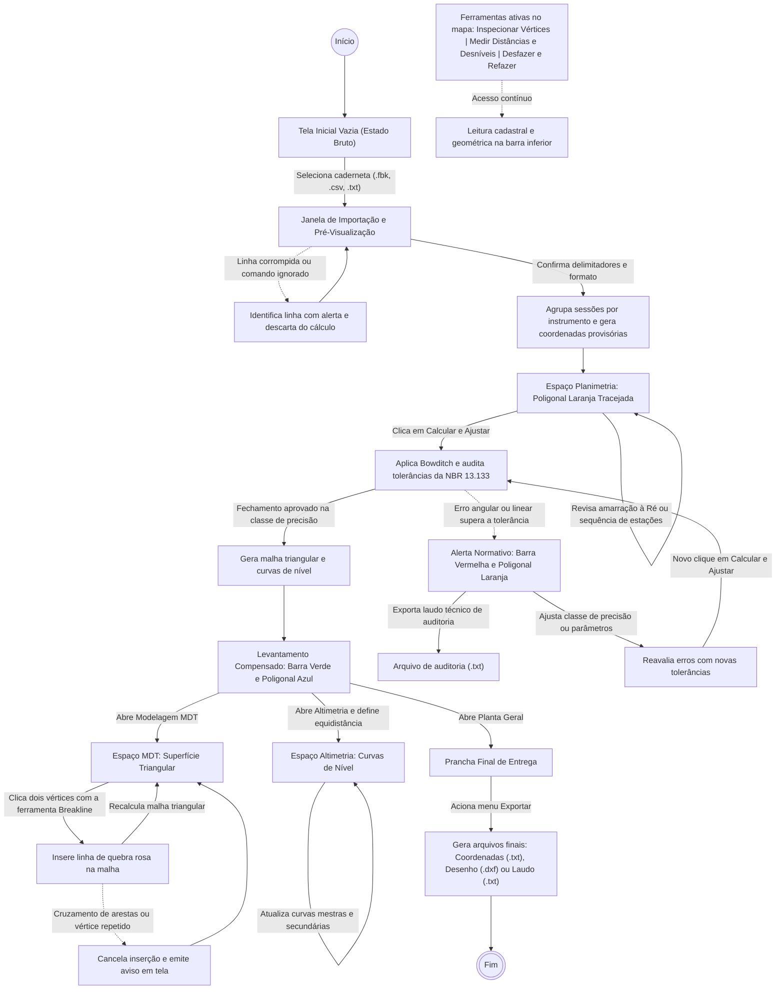

---

## Ciclo de Estados e Travas de Interface

O sistema impede a geração de produtos inválidos por meio de uma máquina de estados:

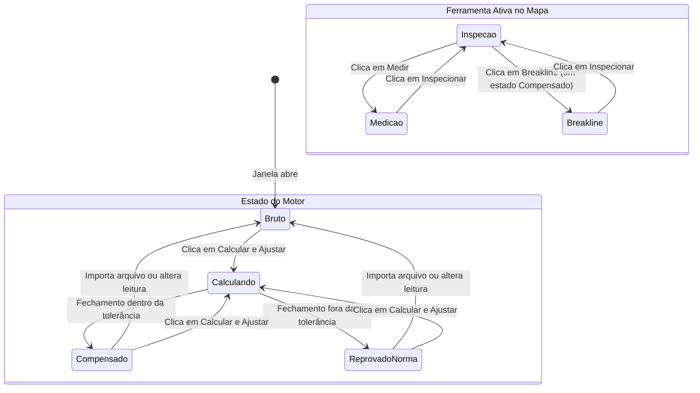

* **Estado `Bruto`**: Exportações vetoriais bloqueadas. O menu `Exportar ▾` exibe aviso de bloqueio prévio. Linhas de quebra ficam desabilitadas.
* **Estado `Calculando`**: Trava reentrâncias de cálculo e edição de tabelas durante a execução das rotinas em segundo plano.
* **Estado `Compensado`**: Libera exportação de arquivos `.dxf` em camadas, arquivos de coordenadas com memória de cálculo `.txt`, criação de linhas de quebra e ferramentas altimétricas.
* **Estado `ReprovadoNorma`**: Bloqueia exportações cartográficas e geração de superfícies. Libera a emissão do laudo técnico de não conformidade para reorientação dos trabalhos de campo.

---

## Demonstração Visual com Caso Real de Campo

As telas abaixo foram capturadas durante o processamento do levantamento `113503.FBK` (129 pontos, desnível de 1,979 m).

### 1. Importação Inteligente e Pré-Visualização

O leitor detecta separadores decimais, escala de coordenadas e delimitadores de coluna antes de transferir os dados para a memória:

| Caderneta Autodesk Field Book (`.fbk`) | Arquivo Tabular Delimitado (`.csv`) |
| :---: | :---: |
| 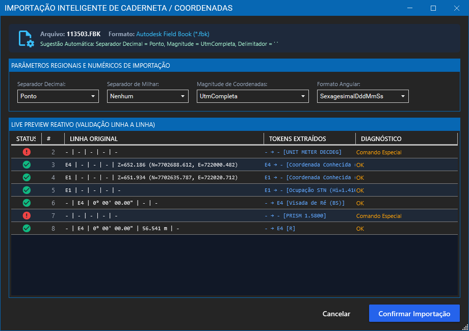 | 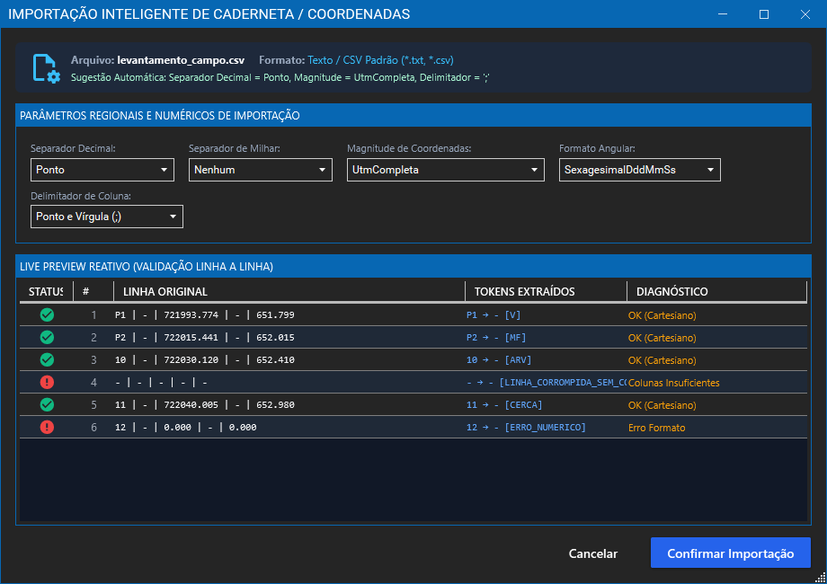 |
| *Identificação de comandos especiais (`UNIT`, `PRISM`) e separação dos pontos medidos.* | *Detecção de colunas incorretas e validação numérica antes da carga.* |

### 2. Esboço Inicial e Revisão de Sessões

Após a confirmação da importação, o sistema agrupa as visadas em sessões de instrumento por altura de mira e desenha a geometria bruta em laranja tracejado:

| Esboço Inicial e Amarração de Partida | Agrupamento por Sessões de Campo |
| :---: | :---: |
| 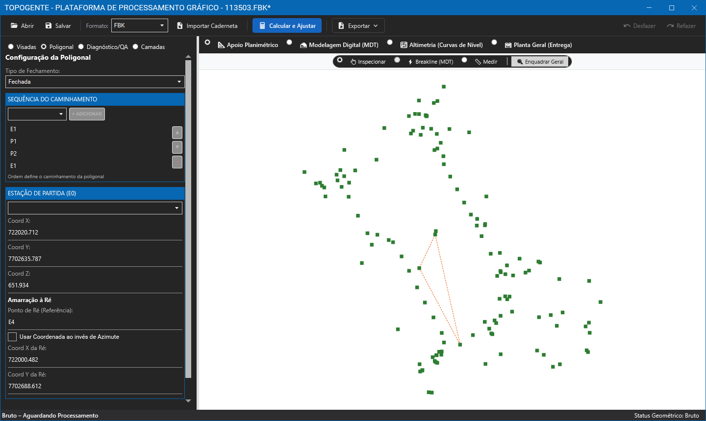 | 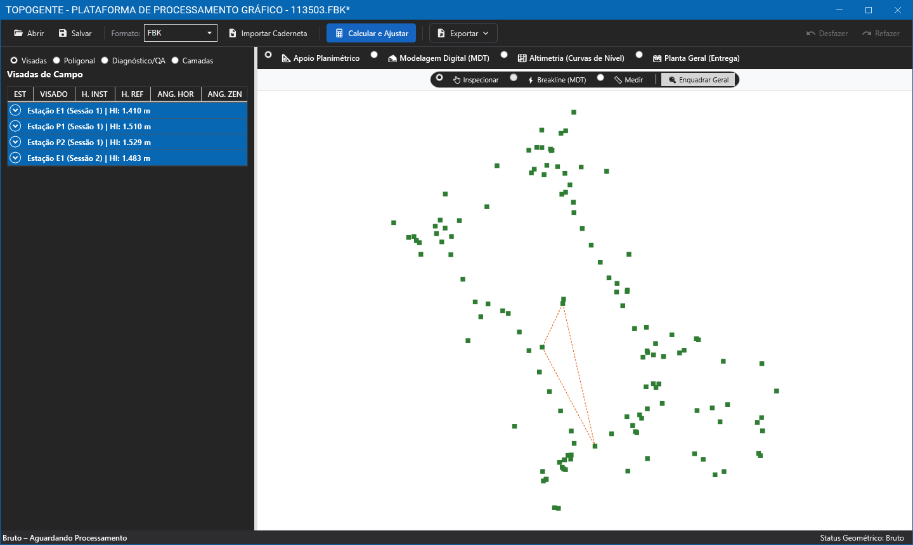 |
| *Preenchimento da estação base E1, ré E4 e projeção preliminar no mapa.* | *Separação das leituras por altura do instrumento (HI).* |

### 3. Compensação de Bowditch e Auditoria de Qualidade (NBR 13.133)

Ao clicar em `Calcular e Ajustar`, o motor avalia o erro angular e o erro linear total. Se aprovado, a barra de status muda para verde e a poligonal passa a ser desenhada em azul contínuo:

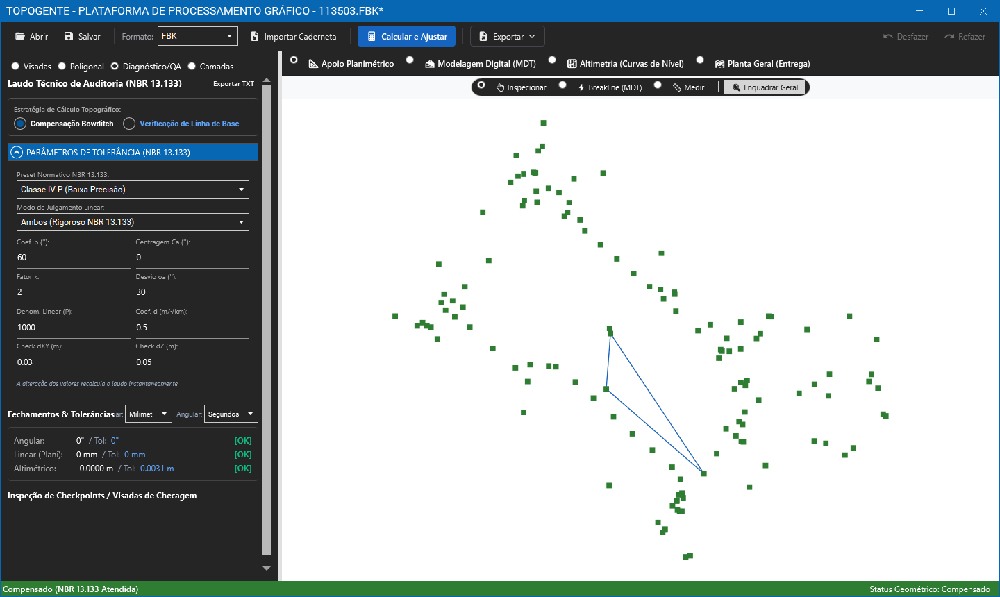

Quando o fechamento supera os limites normativos (ou em verificação de linha de base com erro excessivo), a barra inferior passa para vermelho e as exportações finais são travadas:

| Reprovação em Verificação de Linha de Base | Reprovação Angular na Classe I-P |
| :---: | :---: |
| 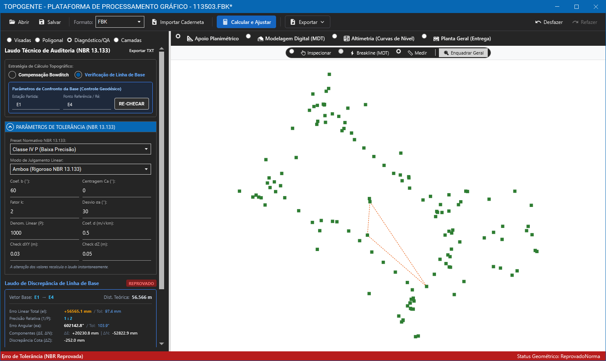 | 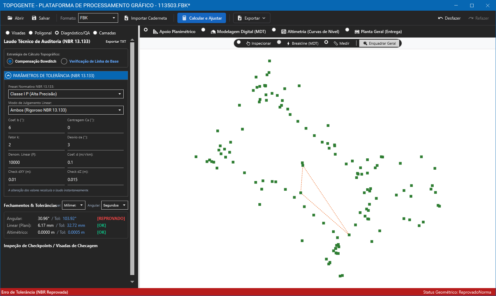 |
| *Detecção de divergência métrica entre pontos de apoio conhecidos.* | *Retorno da poligonal ao traçado laranja e emissão do laudo técnico.* |

### 4. Modelagem Digital do Terreno (MDT) e Linhas de Quebra

A superfície é calculada por triangulação de Delaunay com restrições (CDT). O operador insere linhas de quebra (cristas, talvegues, bordos de pista) clicando em vértices do terreno:

| Malha Triangular (244 elementos) | Inserção de Breakline e Recálculo da Malha |
| :---: | :---: |
| 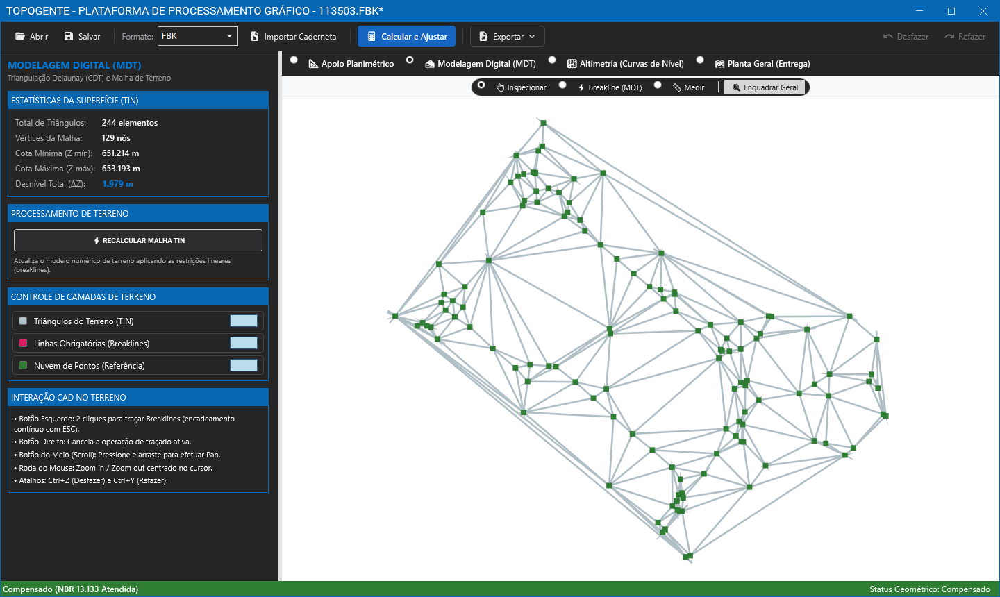 | 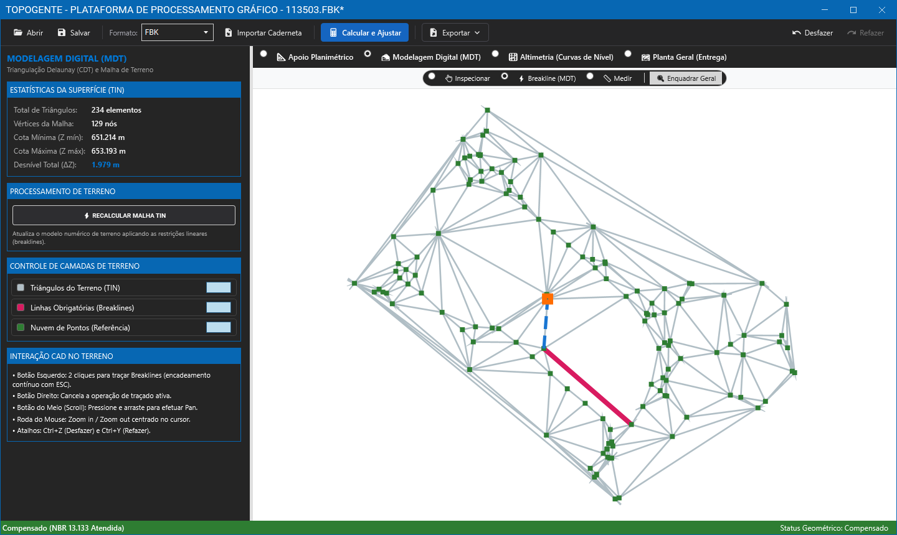 |
| *Triangulação respeitando a nuvem de 129 pontos.* | *Linha rosa obrigatória forçando a reorganização dos triângulos para 234 elementos.* |

### 5. Altimetria e Curvas de Nível

O módulo altimétrico interpola curvas mestras e secundárias sobre a malha triangular com equidistância configurável:

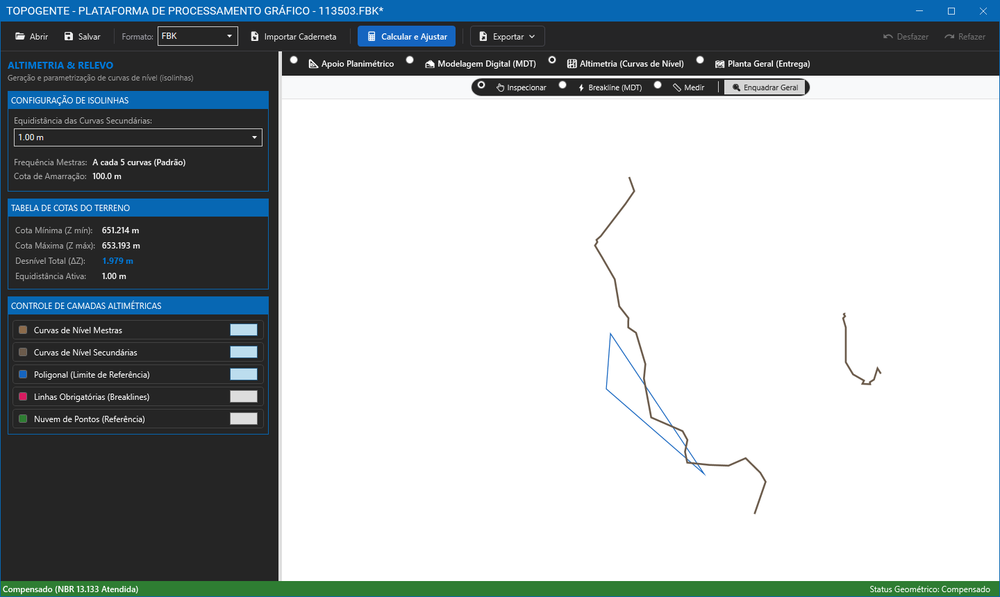

### 6. Ferramentas CAD do Viewport

O motor gráfico inclui indexação espacial em memória ($K$-d Tree e BVH) para resposta imediata sem alocação de objetos no ciclo de renderização:

| Inspeção Cadastral de Ponto | Medição Vetorial com HUD em Tempo Real |
| :---: | :---: |
| 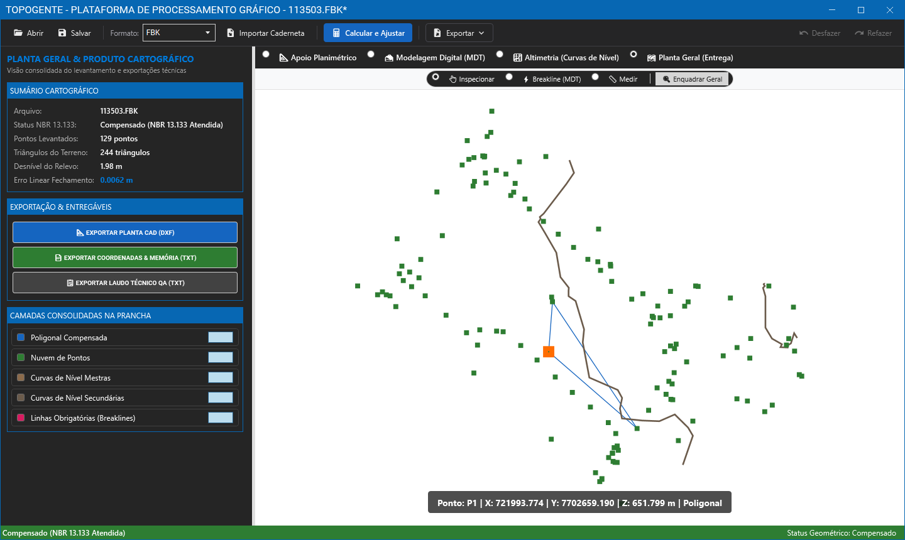 | 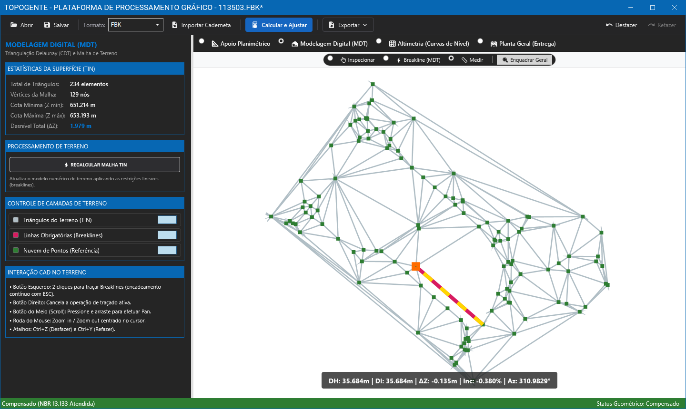 |
| *Identificação de coordenadas X, Y, Z e classificação do vértice.* | *Cálculo de distância horizontal, inclinada, desnível, inclinação e azimute.* |

### 7. Prancha de Entrega e Exportação de Entregáveis

O espaço de entrega consolida o sumário cartográfico da poligonal e libera os arquivos de saída:

| Prancha de Saída Consolidada | Menu de Exportação Explicativo |
| :---: | :---: |
| 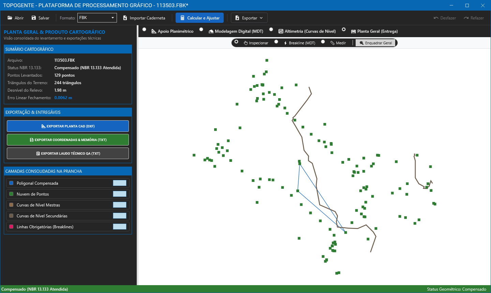 | 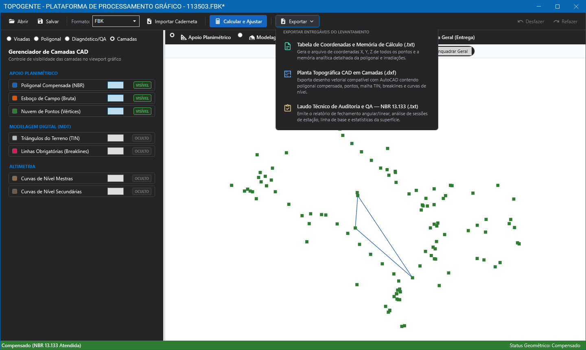 |
| *Exibição simultânea de poligonal, malha, curvas e pontos irradiados.* | *Opções detalhadas: Coordenadas (.txt), Desenho (.dxf) e Laudo (.txt).* |

---

## Formulação Matemática Implementada

### 1. Tolerâncias Normativas (NBR 13.133)

* **Tolerância Angular Admissível ($T_a$):**

  $$T_a = b \cdot \sqrt{n} + C_a$$

  Onde $b$ é o coeficiente angular da classe em segundos de arco, $n$ é o número de vértices ocupados da poligonal e $C_a$ representa o termo aditivo de centragem instrumental.

* **Tolerância Linear Absoluta Admissível ($T_P$):**

  $$T_P = c + d \cdot \sqrt{L_{km}}$$

  Onde $c$ é a constante linear em metros, $d$ é o coeficiente por raiz de quilômetro e $L_{km}$ é o perímetro total em quilômetros.

* **Tolerância Linear Relativa ($T_l$):**

  $$T_l = \frac{L}{P}$$

  Onde $P$ é o denominador da precisão linear mínima da classe (ex.: $1:10.000$ para Classe I-P, $1:5.000$ para Classe II-P).

* **Tolerância Altimétrica ($T_z$):**

  $$T_z = \left(\frac{c}{1000}\right) \cdot \sqrt{L_{km}}$$

### 2. Compensação Planimétrica pelo Método de Bowditch

A distribuição do erro linear total de fechamento ($\Delta X$ e $\Delta Y$) ocorre em proporção direta à extensão de cada lance:

$$C_{X_i} = - \Delta X \cdot \frac{D_i}{\sum D}, \quad C_{Y_i} = - \Delta Y \cdot \frac{D_i}{\sum D}$$

Onde $D_i$ é a distância horizontal do alinhamento $i$ e $\sum D$ é o perímetro total da poligonal.

---

## Como Compilar e Executar

### Pré-requisitos

* Windows 10 ou 11 (64 bits).
* [.NET 10 SDK](https://dotnet.microsoft.com/download/dotnet/10.0) instalado.
* Visual Studio 2022 (versão 17.12 ou superior) ou Visual Studio Code com extensão C# Dev Kit.

### Compilação via Linha de Comando

1. Clone o repositório:
   ```bash
   git clone https://github.com/SeuUsuario/TopoGente.git
   cd TopoGente
   ```

2. Restaure as dependências e compile a solução:
   ```bash
   dotnet build TopoGENTE_.slnx
   ```

3. Execute a aplicação gráfica:
   ```bash
   dotnet run --project TopoGente.UI/TopoGente.UI.csproj
   ```

### Execução dos Testes Automatizados

O projeto contém testes de unidade e de integração isolados de interface gráfica e testes de ponta a ponta do ViewModel:

```bash
# Executa a suíte de cálculos topográficos, regras normativas e algoritmos puros
dotnet test TopoGENTE.Test/TopoGENTE.Test.csproj

# Executa a suíte de testes de interação de telas e comandos do ViewModel
dotnet test TopoGente.UI.E2ETests/TopoGente.UI.E2ETests.csproj
```

---

## Licença e Créditos

Desenvolvido no **GENTE** (Grupo de Engenharia e Tecnologias Espaciais) da **Universidade Federal de Viçosa (UFV)** como plataforma de engenharia para cálculo e cartografia topográfica profissional. Baseado nos princípios teóricos da ABNT NBR 13.133 e na literatura clássica de Topografia e Geodésia.
